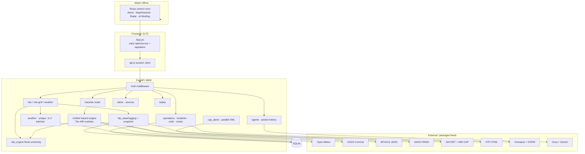

# Vanta Protocol

**CipherCop 2026 — AI Disaster Response track (v2)**

A watch-officer control room for **Hyderabad multi-hazard response** (urban flood / waterlogging first, plus independent earthquake, cyclone, and wildfire monitoring).  
It is a **decision loop**, not a weather toy: live feeds screen risk, the system drafts options, and a human officer approves anything that matters (calendar windows, hazard actions, SMS, dispatch).

Nothing is auto-dispatched. Missing data stays blank — never invented.  
**No combined “total risk” score** — hazards stay on separate physical scales (`total_risk_score` is always `null`).

---

## Table of contents

1. [What you get](#what-you-get)
2. [How to run (absolute beginner)](#how-to-run-absolute-beginner)
3. [Sign in](#sign-in)
4. [Multi-hazard engine](#multi-hazard-engine)
5. [Architecture (current build)](#architecture-current-build)
6. [Live data sources](#live-data-sources)
7. [Control-room tabs](#control-room-tabs)
8. [What the software will / will not do](#what-the-software-will--will-not-do)
9. [Optional: SMS, labels, offline scripts](#optional-sms-labels-offline-scripts)
10. [Useful URLs](#useful-urls)
11. [Project layout](#project-layout)
12. [Deeper technical docs](#deeper-technical-docs)

---

## What you get

| Piece | Role |
|---|---|
| **Backend** (FastAPI, port `8000`) | Weather, CAP, HTP flood screening, unified hazards API, routing, AI agents; SQLite for officer data |
| **Frontend** (React + Vite, port `5173`) | Control room: Alerts → Map (incl. Hazards) → Radar → AI Briefing |
| **Officer login** | Local username/password in SQLite (no Google / Auth0) |
| **Human gate** | Evacuation calendar, hazard action approvals, and SOS SMS need an officer |

**Hyderabad focus:** ~64 HTP waterlogging points across GHMC, a 120-cell city grid, Greater Hyderabad CAP districts, plus India-box earthquake / NIO cyclone / FIRMS fire layers.

---

## How to run (absolute beginner)

You need **two programs** installed on your PC:

| Tool | Why | Check it works |
|---|---|---|
| **Python 3.10+** | Runs the API server | `python --version` |
| **Node.js 18+** (includes `npm`) | Runs the website | `node --version` and `npm --version` |

Also: a code editor and **two terminal windows** (one for backend, one for frontend).

### Step 0 — Open the project folder

```powershell
cd "C:\Users\YOUR_NAME\Desktop\Vanta Protocol"
```

(Use your real path.)

### Step 1 — Create a Python virtual environment (once)

A **venv** is a private Python folder so project packages do not mess up your system Python.

**Windows (PowerShell):**

```powershell
python -m venv venv
.\venv\Scripts\Activate.ps1
python -m pip install --upgrade pip
pip install -r requirements.txt
```

**macOS / Linux:**

```bash
python3 -m venv venv
source venv/bin/activate
python -m pip install --upgrade pip
pip install -r requirements.txt
```

If PowerShell blocks activation, run once:

```powershell
Set-ExecutionPolicy -Scope CurrentUser RemoteSigned
```

Then try `Activate.ps1` again.

### Step 2 — Create your `.env` file (once)

Secrets live in `.env` at the **project root**. Never commit that file.

```powershell
copy .env.example .env
```

macOS / Linux: `cp .env.example .env`

Open `.env` and set at least:

```env
AUTH_REQUIRED=true
BOOTSTRAP_OFFICER_USERNAME=watch.officer
BOOTSTRAP_OFFICER_PASSWORD=change-me-now
BOOTSTRAP_OFFICER_DISPLAY_NAME=Watch Officer
```

**Change the password.** Do not use shared demo passwords from old docs.

Optional keys:

```env
GROQ_API_KEY=              # Predict agent
GEMINI_API_KEY=            # Prepare + Respond agents
MAP_KEY=                   # or NASA_FIRMS_MAP_KEY — live wildfire layer
```

Weather, elevation, OSM, OSRM, USGS earthquakes, and packaged IBTrACS samples work **without** paid keys. Without a FIRMS map key, wildfire status is honest `missing_credentials` (no fake fires).

### Step 3 — Install frontend packages (once)

```powershell
cd frontend
npm install
cd ..
```

### Step 4 — (Optional) Refresh hazard datasets

Packaged sample JSON under `data/` is enough to boot. To refresh from public feeds:

```powershell
.\venv\Scripts\python.exe scripts/fetch_hazard_data.py --hazard all
```

### Step 5 — Start the backend (terminal 1)

Stay in the project root. Activate the venv if it is not already active.

**Windows:**

```powershell
.\venv\Scripts\Activate.ps1
.\venv\Scripts\python.exe -m uvicorn backend.main:app --host 127.0.0.1 --port 8000
```

**macOS / Linux:**

```bash
source venv/bin/activate
python -m uvicorn backend.main:app --host 127.0.0.1 --port 8000
```

Leave this window open. You should see something like `Uvicorn running on http://127.0.0.1:8000`.

Quick check: [http://127.0.0.1:8000/api/health](http://127.0.0.1:8000/api/health) → `"status":"online"`.

### Step 6 — Start the frontend (terminal 2)

```powershell
cd frontend
npm run dev
```

Open **[http://127.0.0.1:5173](http://127.0.0.1:5173)**.

### Step 7 — Sign in and enter the control room

1. Landing page → sign in with the **bootstrap username / password from your `.env`**
2. Enter the control room
3. Source status and CAP alerts load early; weather uses **batched unique ~0.1° cells**
4. On **Tactical Map → Hazards**, toggle earthquake / cyclone / wildfire / flood layers and approve or reject suggested actions

### Stuck?

| Symptom | Likely fix |
|---|---|
| `python` not found | Install Python 3.10+ and tick “Add to PATH” |
| `npm` not found | Install Node.js LTS |
| Port 8000 already in use | Stop the other process on 8000, or change uvicorn `--port` |
| UI says unauthorized / blank APIs | Sign in again; confirm bootstrap password in `.env`; restart backend |
| Agents say setup required | Add `GROQ_API_KEY` / `GEMINI_API_KEY` and restart backend |
| Wildfire missing credentials | Set `MAP_KEY` or `NASA_FIRMS_MAP_KEY` in `.env` |
| HTP / weather failed | Internet required; status bar shows `failed` / `stale` honestly |

### Tests (optional)

```powershell
.\venv\Scripts\python.exe -m pytest tests
```

---

## Sign in

Control-room APIs use **local officer accounts** in SQLite (bcrypt passwords, opaque session token via cookie or `Authorization: Bearer`).

1. Set `AUTH_REQUIRED=true` and bootstrap fields in `.env`
2. Restart backend — the bootstrap user is created **once** if missing
3. Sign in from the landing page

Public even when auth is on: `GET /api/health`, `POST /api/sos/status`.  
Everything else under `/api` needs a session when `AUTH_REQUIRED=true`.

---

## Multi-hazard engine

Hazards are **independent modules**. They are never summed into one score.

### Tier A — real public telemetry

| Module | Source | Notes |
|---|---|---|
| **Earthquake** | USGS ComCat (India bbox) | Observed seismicity only — **no prediction** |
| **Cyclone** | NOAA IBTrACS NIO tracks | Track / pressure / gale radii; wind not mixed into flood score |
| **Wildfire** | NASA FIRMS VIIRS/MODIS | Needs map key; otherwise `missing_credentials` |
| **Urban flood** | HTP points + Open-Meteo | Screening levels 1–5 via `risk_engine` |

### Tier B — interface + explicit sensor deficits

Modules such as landslide, drought, tsunami, lightning, volcano, etc. implement the shared interface and return `not_implemented: missing …` instead of inventing numbers. Details: [`docs/KNOWN_LIMITATIONS.md`](docs/KNOWN_LIMITATIONS.md).

### Officer hazard actions

Suggested mitigations start as `suggested`. Officers approve or reject:

- `POST /api/hazards/actions/{action_id}/approve`
- `POST /api/hazards/actions/{action_id}/reject`

---

## Architecture (current build)

Merged through **`origin/main` multi-hazard upgrade** + **`search` feed-speed / README work**.

### System diagram



### Request path (live mode)

1. Officer signs in → session token  
2. UI starts **source status + CAP** immediately  
3. In parallel: HTP risk zones, batched weather, city grid, units/incidents, **unified hazards**, operations plan  
4. Flood risk engine screens hotspots; hazard modules emit independent features + suggested actions  
5. Watch / heavy lines → draft evacuation window → **officer approves**  
6. AI Briefing runs only on explicit start + provider consent  

### Replay mode

Toggle **Replay**, pick an IST date → archive rain scores HTP + grid and drafts a plan.  
Banner: `REPLAY — historical data, not live`. No writes to incidents, units, SMS, or calendar.

### Performance notes

| Area | Behavior |
|---|---|
| Weather | ~64 HTP points → ~5 unique Open-Meteo ~0.1° cells, batched |
| CAP | XML bodies concurrent (semaphore 6), then SQLite write |
| UI | Source bar / alerts start before the heavy `Promise.all` |

---

## Live data sources

Feeds are real (or packaged public extracts). Status bar: `live` / `partial` / `stale` / `failed` / `missing_credentials`.

| Domain | Source | Used for |
|---|---|---|
| Rainfall & weather | Open-Meteo Forecast | Current / today / 48h precip (IST) |
| River discharge | Open-Meteo GloFAS | Basin overflow context |
| Elevation | Open-Elevation | Terrain context |
| Shelters / routing | Overpass + OSRM | Corridors clear of officer blocks |
| Official alerts | SACHET + IMD CAP | Greater Hyderabad LGD match |
| Waterlogging points | HTP HTML | ~64 GHMC points + SQLite snapshot |
| Earthquakes | USGS ComCat | Observed events (India bbox) |
| Cyclones | IBTrACS (packaged / refreshed) | NIO track exposure |
| Wildfires | NASA FIRMS | Active fire detections (key required) |
| City grid | Open-Meteo batched | 120 GHMC cells |
| Predict / Prepare / Respond | Groq / Gemini | Consented AI briefing |
| SMS | Twilio or MSG91 | Officer-approved; test mode default |

---

## Control-room tabs

| Tab | Purpose |
|---|---|
| **Alerts** | CAP / SACHET for Greater Hyderabad |
| **Tactical Map** | HTP hotspots, grid, incidents, units, corridors, **Hazards** sub-panel |
| **Radar** | External radar / windy-style view |
| **AI Briefing** | Predict (Groq) · Prepare · Respond (Gemini) |

---

## What the software will / will not do

**Will**

- Screen flood risk with explainable heuristics  
- Show independent Tier A hazard observations  
- Draft evacuation windows, corridors, and hazard actions for officer review  
- Keep empty incidents/units until an officer enters them  
- Show honest empty / failed / stale / missing-credentials states  

**Will not**

- Invent weather, fires, quakes, incidents, units, or ETAs  
- Predict earthquakes  
- Auto-dispatch or auto-send SMS  
- Produce a single combined multi-hazard risk number  
- Claim a calibrated flood ML model in production (offline eval only; see `docs/model_report.md`)  

**Data policy:** [`agent_rules.md`](./agent_rules.md).

---

## Optional: SMS, labels, offline scripts

### Going live with SMS

`SMS_TEST_MODE=true` by default → logged only. Set `SMS_TEST_MODE=false`, configure Twilio or MSG91 in `.env`, restart. India needs a DLT template (see `.env.example`).

### Waterlogging labels (offline)

| Path | Role |
|---|---|
| `data/labels/hyderabad_events.csv` | Human-verified labels only |
| `docs/LABELING_GUIDE.md` / `docs/MODEL_TRAINING_GUIDE.md` | How to label / train gates |
| `python scripts/validate_labels.py` | Gate check |
| `python scripts/train_model.py` | Event-day eval (or LOEO with both classes) |
| `docs/model_report.md` | Latest eval write-up |

Current status: **32 sourced positives / 5 events / 0 verified negatives** → no binary classifier fit; **event-day evaluation** only. Live flood score stays rule-based.

### Trigger-frequency backtest

```powershell
.\venv\Scripts\python.exe scripts/backtest_thresholds.py
```

Writes `docs/backtest_report.md` (64 points → 5 unique weather cells).

---

## Useful URLs

| URL | What |
|---|---|
| http://127.0.0.1:5173 | Control-room UI |
| http://127.0.0.1:8000/api/health | Backend alive? |
| http://127.0.0.1:8000/docs | Interactive API docs |
| http://127.0.0.1:8000/api/sources | Feed health |
| http://127.0.0.1:8000/api/risk-zones | HTP points |
| http://127.0.0.1:8000/api/risk-grid | City grid |
| http://127.0.0.1:8000/api/weather | Per-zone weather (batched) |
| http://127.0.0.1:8000/api/alerts | CAP alerts |
| http://127.0.0.1:8000/api/hazards | Unified hazard features |
| http://127.0.0.1:8000/api/hazards/modules | Module status |
| http://127.0.0.1:8000/api/replay?date=2024-09-01 | Historical day |

---

## Project layout

```
Vanta Protocol/
├── .env.example
├── requirements.txt
├── agent_rules.md
├── data/                      # labels, IBTrACS/FIRMS/quake samples, HTP seeds
├── docs/                      # audits, catalogs, model + backtest reports
├── scripts/                   # validate_labels, train_model, fetch_hazard_data, …
├── tests/
├── backend/
│   ├── main.py
│   ├── auth/
│   ├── agents/
│   ├── data_sources/
│   ├── services/
│   │   ├── risk_engine.py
│   │   ├── hazards/           # unified engine + Tier A/B modules
│   │   └── …
│   └── routers/               # incl. hazards.py
└── frontend/src/
    ├── App.jsx
    ├── api.js
    └── components/            # Map, HazardDetailPanel, alerts, agents, …
```

---

## Deeper technical docs

- [`docs/VANTA_IMPLEMENTATION_REPORT.md`](docs/VANTA_IMPLEMENTATION_REPORT.md)  
- [`docs/API_DOCUMENTATION.md`](docs/API_DOCUMENTATION.md)  
- [`docs/DATASET_CATALOG.md`](docs/DATASET_CATALOG.md)  
- [`docs/DATA_PIPELINE.md`](docs/DATA_PIPELINE.md)  
- [`docs/MODEL_TRAINING_GUIDE.md`](docs/MODEL_TRAINING_GUIDE.md)  
- [`docs/KNOWN_LIMITATIONS.md`](docs/KNOWN_LIMITATIONS.md)  
- [`docs/PROGRESS.md`](docs/PROGRESS.md)  
- [`docs/backtest_report.md`](docs/backtest_report.md) · [`docs/model_report.md`](docs/model_report.md)  

---

## Roadmap (not mixed into one score)

- Independent Windy cross-check for wind / precip  
- CAP can raise the **operations calendar** floor; it still does not change the numeric flood map score  
- Tier B modules stay explicit deficits until real sensors exist  
- Flood threshold tuning only after verified **negative** labels exist
