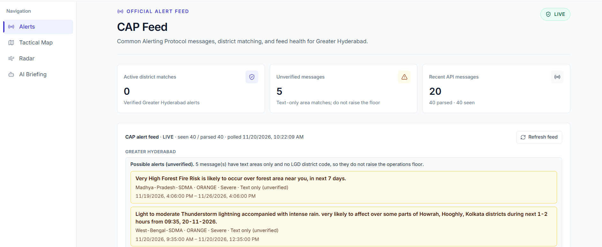
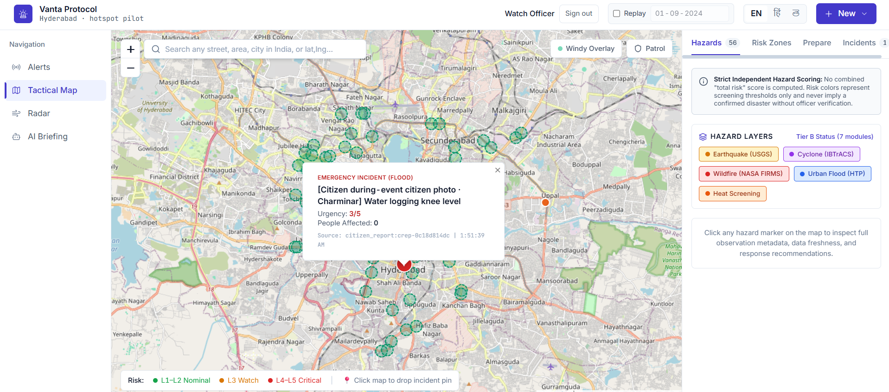
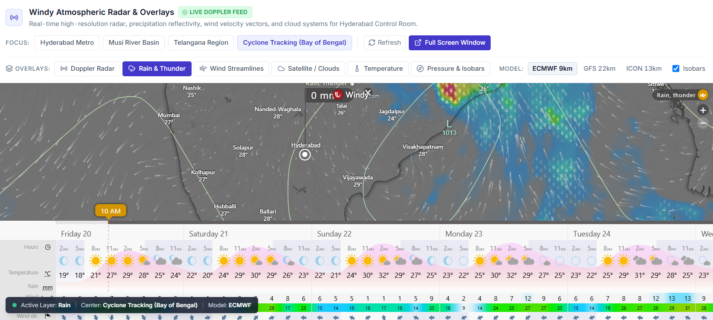
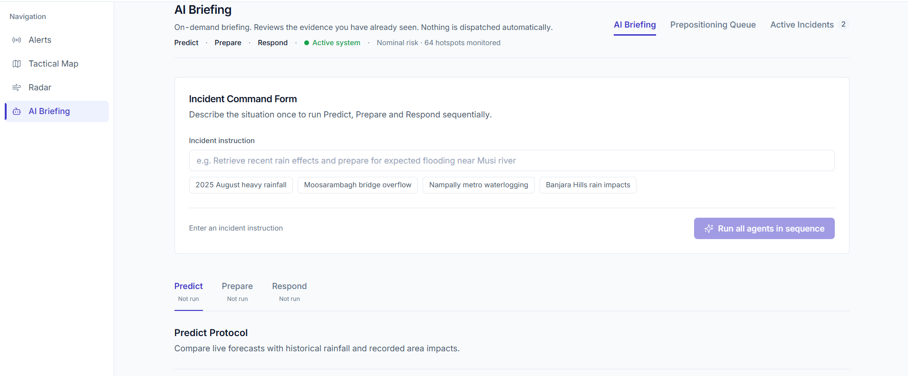
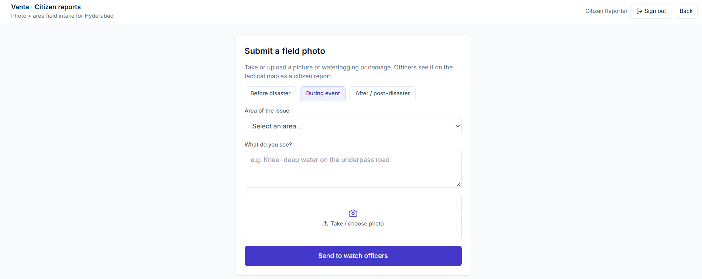
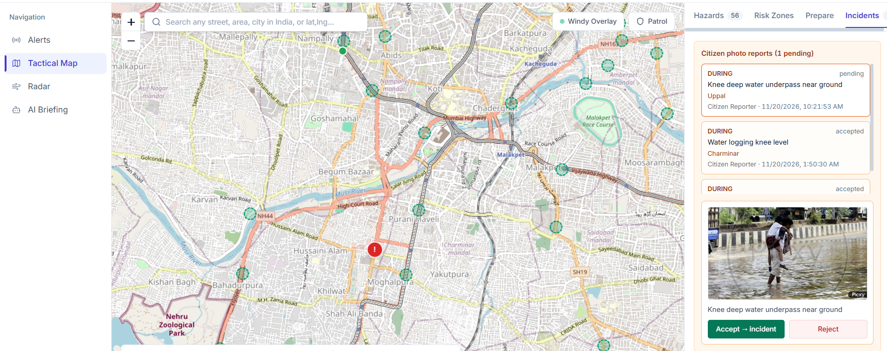
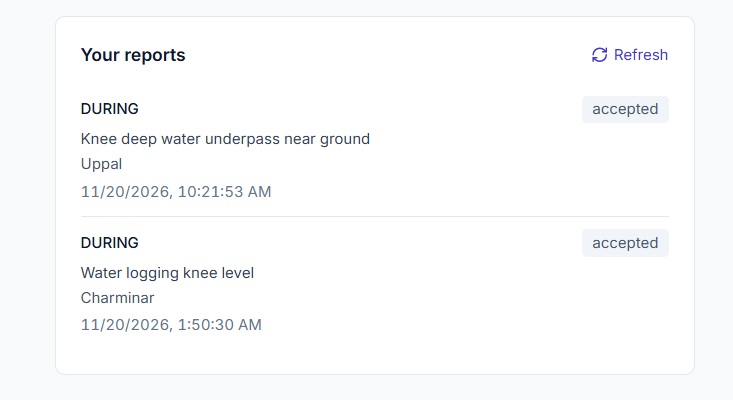
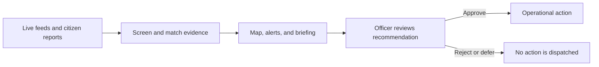
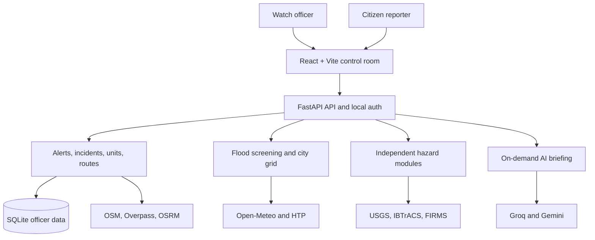

<div align="center">

# VANTA PROTOCOL

### A live decision room for Hyderabad’s multi-hazard response

**See the signal. Understand the situation. Let a watch officer decide.**

*CipherCop 2026 · AI Disaster Response track*

[](https://www.python.org/)
[](https://fastapi.tiangolo.com/)
[](https://react.dev/)
[](https://vite.dev/)
[](#hyderabad-first)
[](#built-for-human-decisions)

[Explore the product](#the-control-room) · [Run it locally](#run-vanta-locally) · [Architecture](#how-the-pieces-fit)

</div>

---

> **Vanta is a decision-support system, not an automatic dispatcher.** It brings live hazard signals, citizen reports, and operational context into one control room. Recommendations remain explainable and an officer approves actions that matter.

## At a glance

| **One city, multiple signals** | **One clear decision loop** | **One human in control** |
|:--|:--|:--|
| Urban waterlogging screening, official alerts, earthquake observations, cyclone tracks, and wildfire detections. | Monitor → assess → prepare → review. Evidence and freshness stay visible. | No automatic dispatch, SMS, or calendar action. Hazards are never collapsed into a misleading total-risk number. |

## The control room

Vanta brings the operations view and citizen reporting flow together. Select a screen to see it larger.

<details open>
<summary><strong>01 · Official alert feed</strong> — CAP messages, district matching, and feed health</summary>



</details>

<details>
<summary><strong>02 · Tactical map</strong> — independent hazard layers, hotspots, and incident context</summary>



</details>

<details>
<summary><strong>03 · Atmospheric radar</strong> — radar and weather overlays for Hyderabad and the region</summary>



</details>

<details>
<summary><strong>04 · AI briefing</strong> — run Predict, Prepare, and Respond when an officer asks</summary>



</details>

<details>
<summary><strong>05 · Citizen reporting</strong> — submit a field photo and area for officer review</summary>



</details>

<details>
<summary><strong>06 · Officer review</strong> — inspect a report, then accept it as an incident or reject it</summary>



</details>

<details>
<summary><strong>07 · Report status</strong> — citizens can see whether a report is pending or accepted</summary>



</details>

## The response loop



### Built for human decisions

- **Independent hazard scales.** Flood, earthquake, cyclone, and wildfire observations remain separate. `total_risk_score` is always `null`.
- **Evidence before action.** Suggestions include context and source status; AI agents run only on explicit request and provider configuration.
- **No fabricated activity.** Incidents and units come from real input. Missing or stale feeds stay visibly missing or stale.
- **Officer approval gates actions.** No automatic dispatch, SMS, evacuation calendar write, or hazard-action approval.
- **Replay is read-only.** Historical replay is labelled and does not write to live operations.

## Hyderabad first

The pilot focuses on Greater Hyderabad and GHMC. It combines roughly 64 HTP waterlogging points, a 120-cell city grid, district-matched CAP alerts, and independent regional hazard feeds. Counts and coverage depend on source availability; the UI reports source health and does not treat a missing feed as a clear area.

| Signal | Source | What Vanta shows |
|:--|:--|:--|
| Rain and forecast | [Open-Meteo](https://open-meteo.com/) | Current and forecast precipitation, batched by unique grid cells |
| River context | Open-Meteo Flood / GloFAS | Basin discharge context |
| Official alerts | SACHET + IMD CAP | Messages matched to Greater Hyderabad districts |
| Waterlogging | HTP | GHMC points and a SQLite snapshot |
| Earthquakes | [USGS ComCat](https://earthquake.usgs.gov/fdsnws/event/1/) | Observed seismic events; no prediction |
| Cyclones | NOAA IBTrACS | North Indian Ocean track context |
| Wildfire | NASA FIRMS | Active fire detections; requires a map key |
| Terrain and routing | Open-Elevation, Overpass, OSRM | Elevation context, mapped locations, and routes |
| AI briefing | Groq + Gemini | Consented Predict, Prepare, and Respond assistance |
| SMS | Twilio or MSG91 | Officer-approved; test mode logs only |

> **Hazard coverage is deliberately honest.** Tier A modules use public observations or live sources. Tier B modules without suitable sensors report `not_implemented` or missing data instead of inventing a reading. See [known limitations](docs/KNOWN_LIMITATIONS.md).

## Run Vanta locally

<details open>
<summary><strong>Prerequisites and first-time setup</strong></summary>

- Python 3.10 or later
- Node.js 18 or later (includes npm)
- Two terminal windows

### 1. Create the Python environment

**Windows PowerShell**

```powershell
python -m venv venv
.\venv\Scripts\Activate.ps1
python -m pip install --upgrade pip
pip install -r requirements.txt
```

**macOS / Linux**

```bash
python3 -m venv venv
source venv/bin/activate
python -m pip install --upgrade pip
pip install -r requirements.txt
```

### 2. Configure the environment

```powershell
copy .env.example .env
```

On macOS or Linux, use `cp .env.example .env`. Set local officer login values in `.env` and choose a private password:

```env
AUTH_REQUIRED=true
BOOTSTRAP_OFFICER_USERNAME=watch.officer
BOOTSTRAP_OFFICER_PASSWORD=choose-a-private-password
BOOTSTRAP_OFFICER_DISPLAY_NAME=Watch Officer
```

Optional integrations:

```env
GROQ_API_KEY=       # Predict agent
GEMINI_API_KEY=     # Prepare and Respond agents
MAP_KEY=            # NASA FIRMS wildfire layer
```

Secrets belong in `.env`, which is ignored by Git. Weather, elevation, OSM, OSRM, USGS, and packaged IBTrACS samples can run without paid keys. FIRMS stays `missing_credentials` until a key is set.

### 3. Install frontend packages

```powershell
cd frontend
npm install
cd ..
```

### 4. Start the API

From the project root, in terminal one:

```powershell
.\venv\Scripts\python.exe -m uvicorn backend.main:app --host 127.0.0.1 --port 8000
```

### 5. Start the web app

In terminal two:

```powershell
cd frontend
npm run dev
```

Open **[http://127.0.0.1:5173](http://127.0.0.1:5173)** and sign in with the bootstrap credentials from `.env`.

| Local endpoint | Purpose |
|:--|:--|
| [127.0.0.1:5173](http://127.0.0.1:5173) | Control room |
| [127.0.0.1:8000/api/health](http://127.0.0.1:8000/api/health) | API health |
| [127.0.0.1:8000/docs](http://127.0.0.1:8000/docs) | Interactive API docs |

</details>

<details>
<summary><strong>Optional: refresh packaged hazard datasets</strong></summary>

```powershell
.\venv\Scripts\python.exe scripts/fetch_hazard_data.py --hazard all
```

Packaged samples under `data/` are sufficient to boot the application. Refreshing connects to public feeds.

</details>

<details>
<summary><strong>Optional: enable live SMS</strong></summary>

SMS test mode is enabled by default and logs messages only. To send real messages, configure Twilio or MSG91, set `SMS_TEST_MODE=false`, and restart the backend. India deployments also need an approved DLT template. Treat provider setup and live sending as an operational decision.

</details>

### Common setup fixes

| Symptom | Check |
|:--|:--|
| `python` is not found | Install Python 3.10+ and add it to PATH. |
| `npm` is not found | Install Node.js 18+ and reopen the terminal. |
| Port 8000 is busy | Stop the other process or choose another Uvicorn port. |
| API says unauthorized | Sign in again and check the bootstrap values in `.env`. |
| AI agents need setup | Configure the relevant Groq or Gemini key, then restart the API. |
| Wildfire data is unavailable | Configure `MAP_KEY` or `NASA_FIRMS_MAP_KEY`; otherwise `missing_credentials` is expected. |
| A feed is stale or failed | Check connectivity and the source status shown in the app. No data is substituted. |

## Sign-in and local data

Control-room accounts are stored locally in SQLite. Passwords use bcrypt and sessions use an opaque token in a cookie or `Authorization: Bearer` header. Set `AUTH_REQUIRED=true` and the bootstrap values in `.env`; the bootstrap officer is created once if missing. Health and SOS status remain public when authentication is enabled; other `/api` routes require a session.

The live weather path batches unique roughly 0.1° cells, so the HTP points share upstream requests where possible. CAP XML fetches run concurrently (semaphore 6) before results are written to SQLite. Source status and alerts start before heavier dashboard requests.

## Offline data tools

| Path / command | Purpose |
|:--|:--|
| `data/labels/hyderabad_events.csv` | Human-verified labels only |
| `docs/LABELING_GUIDE.md` | Labeling process |
| `docs/MODEL_TRAINING_GUIDE.md` | Training and evaluation gates |
| `python scripts/validate_labels.py` | Validate label data |
| `python scripts/train_model.py` | Event-day evaluation; LOEO requires both classes |
| `python scripts/backtest_thresholds.py` | Backtest trigger frequency; writes `docs/backtest_report.md` |
## How the pieces fit



**Typical live startup:** authenticate → load source status and CAP early → fetch risk zones, batched weather, grid, units and incidents, hazard modules, and operations context → present evidence and explainable options → wait for an officer decision.

**Replay mode:** choose an IST date to view historical rainfall context and a draft plan. Replay is marked historical and does not write to incidents, units, SMS, or the calendar.

## Control-room guide

| Area | What it is for |
|:--|:--|
| **Alerts** | CAP / SACHET messages matched to Greater Hyderabad |
| **Tactical Map** | HTP hotspots, city grid, incidents, units, corridors, and independent hazard layers |
| **Radar** | Radar, rain, wind, cloud, temperature, and pressure overlays |
| **AI Briefing** | On-demand Predict (Groq), Prepare, and Respond (Gemini) workflow |
| **Citizen reports** | Photo and area intake, followed by watch-officer review |

## API quick links

With the backend running, these local endpoints expose the main feeds:

- [`/api/health`](http://127.0.0.1:8000/api/health) · [`/api/sources`](http://127.0.0.1:8000/api/sources)
- [`/api/alerts`](http://127.0.0.1:8000/api/alerts) · [`/api/hazards`](http://127.0.0.1:8000/api/hazards)
- [`/api/hazards/modules`](http://127.0.0.1:8000/api/hazards/modules) · [`/api/risk-zones`](http://127.0.0.1:8000/api/risk-zones)
- [`/api/risk-grid`](http://127.0.0.1:8000/api/risk-grid) · [`/api/weather`](http://127.0.0.1:8000/api/weather)
- Replay example: `http://127.0.0.1:8000/api/replay?date=2024-09-01`

Control-room endpoints require a session when `AUTH_REQUIRED=true`. Health and SOS status are public.

## Data and model boundaries

- Flood levels 1–5 are heuristic screening outputs from the `risk_engine`; they are not a calibrated production ML model.
- Earthquake observations are not earthquake predictions.
- Text-only CAP area matches without an LGD district code remain unverified and do not raise the operations floor.
- Estimates, risk levels, and triage rankings are model outputs, not confirmed facts. Review their source and explanation.
- Current label status: **32 sourced positives / 5 events / 0 verified negatives**. There is no fitted binary flood classifier; evaluation is event-day only.
- **Next-day rainfall forecaster (separate from flood classification):** `scripts/train_rainfall_forecaster.py` trains a `GradientBoostingRegressor` (log1p mm) and `GradientBoostingClassifier` (heavy rain ≥ 15.6 mm) on Open-Meteo ERA5 archive data for Hyderabad (lat 17.385, lon 78.4867), covering 2015-01-01 to 2026-11-22 (4,313 feature rows after lag engineering; train < 2024-01-01, test ≥ 2024-01-01 with 38 heavy-rain days). It predicts **next-day rainfall and heavy-rain probability only — not urban flooding.** The model is saved to `models/rainfall/model.joblib` only when it beats *both* persistence and day-of-year climatology MAE **and** climatology PR-AUC on the held-out test set.

  **Test metrics vs. baselines (pre-2024 model evaluated on 2024+ test set):**

  | Metric | Model | Persistence | Climatology |
  |:--|:--|:--|:--|
  | MAE (all days) | **1.921 mm** | 2.790 mm | 2.593 mm |
  | MAE (heavy days only, ≥15.6 mm) | 19.325 mm | — | 18.914 mm |
  | PR-AUC (heavy rain) | **0.1389** (95% CI: 0.079–0.230) | — | 0.0595 |
  | Brier score | **0.0351** | — | 0.0368 |
  | ROC-AUC | **0.8376** (95% CI: 0.774–0.906) | — | — |

  **5-fold expanding-window CV (full history):** MAE 2.020 ± 0.386 mm, PR-AUC 0.186 ± 0.067, ROC-AUC 0.849 ± 0.021.

  **Threshold table (test set, classifier):**

  | Threshold | Precision | Recall | F1 | Warnings | TP | FP | Missed |
  |:--|:--|:--|:--|:--|:--|:--|:--|
  | 0.05 | 0.134 | 0.474 | 0.209 | 134 | 18 | 116 | 20 |
  | 0.10 | 0.192 | 0.368 | 0.252 | 73 | 14 | 59 | 24 |
  | 0.20 | 0.282 | 0.289 | 0.286 | 38 | 11 | 27 | 27 |
  | 0.30 | 0.333 | 0.132 | 0.189 | 15 | 5 | 10 | 33 |
  | 0.50 | 0.333 | 0.053 | 0.091 | 6 | 2 | 4 | 36 |

  **Known limitations:**
  - Trained on ERA5 reanalysis (`archive-api.open-meteo.com`); live inference fetches recent days from `api.open-meteo.com/v1/forecast` — minor train/serve source differences apply.
  - `precipitation_probability_max` is NaN in archive (filled as 0 during training) but populated (~25%) in the live forecast API — a known feature mismatch; documented in `docs/MODEL_TRAINING_GUIDE.md`.
  - Heavy-day MAE (19.3 mm) is marginally worse than climatology (18.9 mm) — the classifier catches events, the regressor under-estimates peak amounts.
  - Daily grid totals cannot resolve sub-daily urban cloudbursts.
  - The model is refit on all data before saving; reported metrics come from the pre-2024 split only (documented in `metrics.json`).

  **Commands:**
  ```bash
  # Retrain
  python scripts/train_rainfall_forecaster.py
  # Evaluate without touching the saved model
  python -m scripts.evaluate_rainfall
  # Fill actuals and compute held-out MAE
  python scripts/fill_actuals.py
  ```
  **API endpoints:** `GET /api/predict/rain` · `GET /api/predict/rain/scorecard` (requires ≥ 30 logged days).
- Missing rainfall does not become zero rainfall or nominal risk. Empty units and incidents stay empty until entered from real inputs.

See the [data policy](agent_rules.md), [known limitations](docs/KNOWN_LIMITATIONS.md), and [model report](docs/model_report.md).

## Project map

```text
backend/          FastAPI app, auth, data clients, services, hazard modules, routers
frontend/         React + Vite application and control-room components
data/             Packaged public extracts, HTP seeds, and labels
scripts/           Dataset refresh, validation, training, and backtest utilities
tests/             Automated test suite
 docs/             API, pipeline, implementation, limitations, and model notes
```

## Further reading

- [Implementation report](docs/VANTA_IMPLEMENTATION_REPORT.md)
- [API documentation](docs/API_DOCUMENTATION.md)
- [Dataset catalog](docs/DATASET_CATALOG.md) · [Data pipeline](docs/DATA_PIPELINE.md)
- [Known limitations](docs/KNOWN_LIMITATIONS.md)
- [Model training guide](docs/MODEL_TRAINING_GUIDE.md) · [Latest model report](docs/model_report.md)
- [Labeling guide](docs/LABELING_GUIDE.md) · [Backtest report](docs/backtest_report.md)
- [Progress notes](docs/PROGRESS.md)

---

<div align="center">

**Vanta Protocol · Hyderabad multi-hazard response**<br>
*Evidence-led. Human-approved. Honest about uncertainty.*

</div>