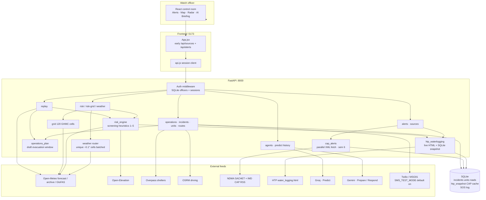

# Vanta Protocol

**CipherCop 2026 — AI Disaster Response track**

A watch-officer control room for **Hyderabad flood / waterlogging response**.  
It is a **decision loop**, not a weather toy: live feeds screen risk, the system drafts options, and a human officer approves anything that matters (calendar windows, SMS, dispatch).

Nothing is auto-dispatched. Missing data stays blank — never invented.

---

## Table of contents

1. [What you get](#what-you-get)
2. [How to run (absolute beginner)](#how-to-run-absolute-beginner)
3. [Sign in](#sign-in)
4. [Architecture (current build)](#architecture-current-build)
5. [Live data sources](#live-data-sources)
6. [Control-room tabs](#control-room-tabs)
7. [What the software will / will not do](#what-the-software-will--will-not-do)
8. [Optional: SMS, labels, offline scripts](#optional-sms-labels-offline-scripts)
9. [Useful URLs](#useful-urls)
10. [Project layout](#project-layout)

---

## What you get

| Piece | Role |
|---|---|
| **Backend** (FastAPI, port `8000`) | Talks to weather, CAP alerts, HTP waterlogging list, maps routing, AI agents; stores officer data in SQLite |
| **Frontend** (React + Vite, port `5173`) | Control-room UI: Alerts → Map → Radar → AI Briefing |
| **Officer login** | Local username/password in SQLite (no Google / Auth0) |
| **Human gate** | Evacuation calendar + SOS SMS need officer approval |

**Hyderabad focus:** ~64 HTP waterlogging points across GHMC, a 120-cell city grid, and Greater Hyderabad CAP district codes.

---

## How to run (absolute beginner)

You need **two programs** installed on your PC:

| Tool | Why | Check it works |
|---|---|---|
| **Python 3.10+** | Runs the API server | `python --version` |
| **Node.js 18+** (includes `npm`) | Runs the website | `node --version` and `npm --version` |

Also: a code editor and **two terminal windows** (one for backend, one for frontend).

### Step 0 — Open the project folder

```powershell
cd "C:\Users\YOUR_NAME\Desktop\Vanta Protocol"
```

(Use your real path.)

### Step 1 — Create a Python virtual environment (once)

A **venv** is a private Python folder so project packages do not mess up your system Python.

**Windows (PowerShell):**

```powershell
python -m venv venv
.\venv\Scripts\Activate.ps1
python -m pip install --upgrade pip
pip install -r requirements.txt
```

**macOS / Linux:**

```bash
python3 -m venv venv
source venv/bin/activate
python -m pip install --upgrade pip
pip install -r requirements.txt
```

If PowerShell blocks activation, run once:

```powershell
Set-ExecutionPolicy -Scope CurrentUser RemoteSigned
```

Then try `Activate.ps1` again.

### Step 2 — Create your `.env` file (once)

Secrets live in `.env` at the **project root**. Never commit that file.

```powershell
copy .env.example .env
```

macOS / Linux: `cp .env.example .env`

Open `.env` and set at least:

```env
AUTH_REQUIRED=true
BOOTSTRAP_OFFICER_USERNAME=watch.officer
BOOTSTRAP_OFFICER_PASSWORD=change-me-now
BOOTSTRAP_OFFICER_DISPLAY_NAME=Watch Officer
```

Change the password. For AI Briefing agents (optional at first):

```env
GROQ_API_KEY=          # Predict agent
GEMINI_API_KEY=        # Prepare + Respond agents
```

Weather, elevation, OSM, and OSRM work **without** keys.

### Step 3 — Install frontend packages (once)

```powershell
cd frontend
npm install
cd ..
```

### Step 4 — Start the backend (terminal 1)

Stay in the project root. Activate the venv if it is not already active.

**Windows:**

```powershell
.\venv\Scripts\Activate.ps1
.\venv\Scripts\python.exe -m uvicorn backend.main:app --host 127.0.0.1 --port 8000
```

**macOS / Linux:**

```bash
source venv/bin/activate
python -m uvicorn backend.main:app --host 127.0.0.1 --port 8000
```

Leave this window open. You should see something like `Uvicorn running on http://127.0.0.1:8000`.

Quick check: open [http://127.0.0.1:8000/api/health](http://127.0.0.1:8000/api/health) — you want `"status":"online"`.

### Step 5 — Start the frontend (terminal 2)

```powershell
cd frontend
npm run dev
```

Leave this window open. Open the UI:

**[http://127.0.0.1:5173](http://127.0.0.1:5173)**

### Step 6 — Sign in and enter the control room

1. Landing page → sign in with the bootstrap username / password from `.env`
2. Enter the control room
3. Source status and CAP alerts load early; weather uses **batched unique ~0.1° cells** (much faster than one request per hotspot)

### Stuck?

| Symptom | Likely fix |
|---|---|
| `python` not found | Install Python 3.10+ and tick “Add to PATH” |
| `npm` not found | Install Node.js LTS |
| Port 8000 already in use | Stop the other process using 8000, or change the uvicorn `--port` |
| UI says unauthorized / blank APIs | Sign in again; confirm `AUTH_REQUIRED` and bootstrap password in `.env`, then restart backend |
| Agents say setup required | Add `GROQ_API_KEY` / `GEMINI_API_KEY` and restart backend |
| HTP / weather failed | Internet required; status bar should show `failed` / `stale` honestly |

### Tests (optional)

From project root, with venv active (HTTP to live providers is mocked in tests):

```powershell
.\venv\Scripts\python.exe -m pytest tests
```

---

## Sign in

Control-room APIs use **local officer accounts** in SQLite (bcrypt passwords, opaque session token via cookie or `Authorization: Bearer`).

1. Set `AUTH_REQUIRED=true` and bootstrap fields in `.env`
2. Restart backend — the bootstrap user is created **once** if missing
3. Sign in from the landing page

Public even when auth is on: `GET /api/health`, `POST /api/sos/status`.  
Everything else under `/api` needs a session when `AUTH_REQUIRED=true`.

`AUTH_REQUIRED` can be `false` for local hacking; production should keep it `true`.

---

## Architecture (current build)

Snapshot through commit **`685593e`** (*Speed up live feeds with batched weather, parallel CAP, and early source status*).

### System diagram



### Request path (live mode)

1. Officer signs in → session token  
2. UI kicks off **source status + CAP** immediately (does not wait for weather)  
3. In parallel: risk zones (HTP), **batched** zone weather, city risk grid, units/incidents, operations plan  
4. Risk engine scores each hotspot with transparent rainfall / wind / discharge / HTP factors  
5. If rain / risk crosses watch lines → draft evacuation window → **officer must approve**  
6. AI Briefing agents run only when the officer starts them and consents to send data to Groq/Gemini  

### Replay mode

Toggle **Replay**, pick an IST date → archive rain scores HTP + grid and drafts a plan.  
Banner: `REPLAY — historical data, not live`.  
No writes to incidents, units, SMS, or calendar.

### Performance notes (latest)

| Area | Behavior |
|---|---|
| Weather | ~64 HTP points → ~5 unique Open-Meteo ~0.1° cells, fetched in batches |
| CAP | CAP XML bodies downloaded concurrently (semaphore 6), then written to SQLite |
| UI | Source bar / alerts start before the heavy `Promise.all` finishes |

---

## Live data sources

Feeds are real and runtime-fetched. The **Source Status Bar** shows `live` / `partial` / `stale` / `failed` plus a timestamp. Reachable ≠ every field present.

| Domain | Source | Used for |
|---|---|---|
| Rainfall & weather | Open-Meteo Forecast | Current / today / rolling 48h precip (IST) |
| River discharge | Open-Meteo GloFAS | Basin overflow context |
| Elevation | Open-Elevation (SRTM) | Terrain context (not a coastal cutoff) |
| Shelters / stations | OSM Overpass | Verified civic POIs for corridors |
| Routing | OSRM | Fastest corridor clear of officer-reported blocks |
| Official alerts | SACHET + IMD CAP | Greater Hyderabad LGD match; can raise calendar floor |
| Waterlogging points | HTP HTML list | ~64 Major/Minor GHMC points; SQLite `htp_snapshot` if poll fails |
| Map tiles | OSM Carto | Basemap |
| City grid | Open-Meteo (batched) | 120 GHMC cells → evacuation evidence |
| Predict | Groq | History question + qualitative forecast (consent) |
| Prepare / Respond | Gemini | Readiness + SOS draft (consent) |
| SMS | Twilio or MSG91 | Officer-approved send; test mode default |

Implementation pointers: `backend/data_sources/`, `backend/services/`, `backend/routers/`.

---

## Control-room tabs

| Tab | Purpose |
|---|---|
| **Alerts** | CAP / SACHET feed for Greater Hyderabad |
| **Tactical Map** | HTP hotspots, risk grid, incidents, units, corridors |
| **Radar** | External radar / windy-style view |
| **AI Briefing** | Predict (Groq) · Prepare · Respond (Gemini) — manual, consented |

---

## What the software will / will not do

**Will**

- Screen flood-related risk with explainable heuristics (`risk_engine.py`)
- Draft evacuation windows and corridors for officer review
- Keep empty incidents/units until an officer enters them
- Show honest empty / failed / stale feed states

**Will not**

- Invent weather, incidents, units, or ETAs
- Auto-dispatch or auto-send SMS
- Claim a calibrated flood ML model in production  
  (offline eval lives in `docs/model_report.md`; live score is still rule-based)
- Treat “no road row” as “roads are clear”

**Data policy:** see [`agent_rules.md`](./agent_rules.md).

---

## Optional: SMS, labels, offline scripts

### Going live with SMS

`SMS_TEST_MODE=true` by default → sends are logged, provider not called.  
Set `SMS_TEST_MODE=false`, configure Twilio or MSG91 in `.env`, restart backend. India delivery needs a DLT-registered template. Details stay in `.env.example`.

### Waterlogging labels (offline)

| Path | Role |
|---|---|
| `data/labels/hyderabad_events.csv` | Human-verified labels only |
| `docs/LABELING_GUIDE.md` | How to label |
| `python scripts/validate_labels.py` | Gate check |
| `python scripts/train_model.py` | Event-day eval (or LOEO when both classes exist) |
| `docs/model_report.md` | Latest eval write-up |

Current status: **32 sourced positives / 5 events / 0 verified negatives** → no binary classifier fit; report uses **event-day evaluation**. Live `risk_engine` is unchanged by that script.

### Trigger-frequency backtest

```powershell
.\venv\Scripts\python.exe scripts/backtest_thresholds.py
```

Writes `docs/backtest_report.md` (64 points → 5 unique weather cells). Frequency only — not labelled accuracy.

---

## Useful URLs

| URL | What |
|---|---|
| http://127.0.0.1:5173 | Control-room UI |
| http://127.0.0.1:8000/api/health | Backend alive? |
| http://127.0.0.1:8000/docs | Interactive API docs |
| http://127.0.0.1:8000/api/sources | Feed health |
| http://127.0.0.1:8000/api/risk-zones | HTP points |
| http://127.0.0.1:8000/api/risk-grid | City grid |
| http://127.0.0.1:8000/api/weather | Per-zone weather (batched cells) |
| http://127.0.0.1:8000/api/alerts | CAP alerts |
| http://127.0.0.1:8000/api/replay?date=2024-09-01 | Historical day (auth required when enabled) |

---

## Project layout

```
Vanta Protocol/
├── .env.example                 # Copy to .env — never commit secrets
├── requirements.txt             # Python deps
├── agent_rules.md               # No mock data / human-in-the-loop
├── data/
│   ├── hyderabad_hotspots.json  # Label seeds only (not runtime catalog)
│   └── labels/                  # Human waterlogging labels
├── docs/
│   ├── backtest_report.md
│   ├── model_report.md
│   ├── rainfall_product_comparison.md
│   └── LABELING_GUIDE.md
├── scripts/                     # validate_labels, train_model, backtest_…
├── tests/                       # pytest (providers mocked)
├── backend/
│   ├── main.py                  # FastAPI app + routers
│   ├── config.py                # Settings from .env
│   ├── db.py                    # SQLite + htp_snapshot
│   ├── auth/                    # Officer sessions
│   ├── agents/                  # Groq Predict · Gemini Prepare/Respond
│   ├── data_sources/            # Open-Meteo, CAP, HTP, OSM, elevation
│   ├── services/                # risk_engine, grid, routing, operations, replay
│   └── routers/                 # HTTP API surface
└── frontend/
    ├── package.json
    └── src/
        ├── App.jsx              # Nav + early sources/CAP + Replay
        ├── api.js
        └── components/          # Map, alerts, agents, intake modals
```

---

## Hazard coverage

Flood screening: Open-Meteo rain/wind, GloFAS discharge, elevation context, HTP list.  
Heat: daily max / feels-like from the same forecast (shown separately; does not change flood level).  
Earthquake / landslide: **not** included — no ground-truth feed connected.

---

## Roadmap (not in live risk score)

- Independent Windy cross-check for wind / precip  
- CAP already can raise the **operations calendar** floor; it still does not change the numeric map flood score  
- Earthquake / landslide if a trustworthy feed appears  
- Threshold tuning only after verified **negative** labels exist
